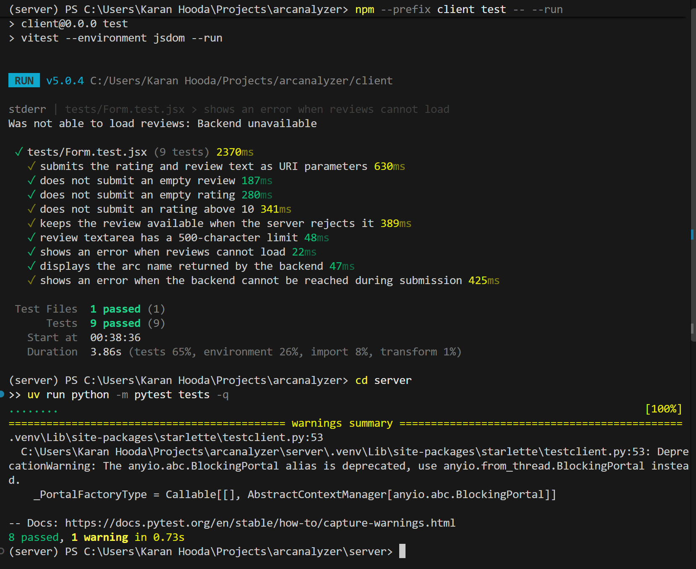
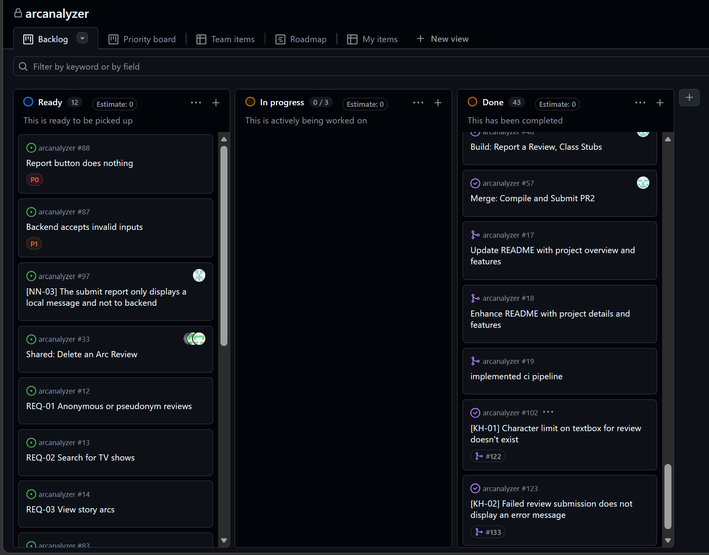

# PR4 Team Report

**Team number:** 2

**Team members:** Hamza Akbari, Karan Hooda, Nhan Nguyen, Sidharth Nair

## 1. Bug Triage Table

| Test name | Bucket | Issue link | Severity | Priority | Owner | Status |
|---|---|---|---|---|---|---|
| HA-02: Rating boundaries are enforced at 0 and 10 | Code bug | [Issue 95](https://github.com/rn727/arcanalyzer/issues/95) | Major | Major | Hamza Akbari | PR 120 merged |
| HA-03: Whitespace-only review text is rejected | Code bug | [Issue 121](https://github.com/rn727/arcanalyzer/issues/121) | Minor | Minor | Hamza Akbari | PR 125 merged |

| KH-01: Reviews longer than 500 characters are rejected | Code bug | [Issue 102](https://github.com/rn727/arcanalyzer/issues/102) | Low | High | Karan Hooda | PR 122 merged |
| KH-02: Failed review submissions display an error message | Code bug | [Issue 123](https://github.com/rn727/arcanalyzer/issues/123) | Low | Medium | Karan Hooda | PR 133 merged |

|  |  |  |  |  |  |  |
|  |  |  |  |  |  |  |
|  |  |  |  |  |  |  |
|  |  |  |  |  |  |  |

## 2. Regression Log

No regressions found.

**Date full test suite was run:** 11/22/2026

## 3. Final Test Run

**Remaining failing tests:** None. All frontend and backend tests passed successfully.

## 4. Feature Decision

[To be completed]

## 5. Board Snapshot

## 6. Sprint Summary

[To be completed]
