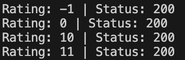
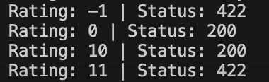
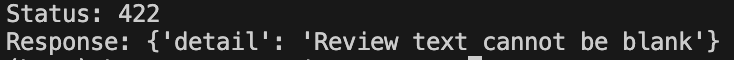

# Hamza Akbari

## Bug 1: Ratings outside the 0–10 range

- Issue: https://github.com/rn727/arcanalyzer/issues/95
- Pull request: https://github.com/rn727/arcanalyzer/pull/120
- Type: Code bug
- Explanation: This was a code bug because the test correctly expected ratings below 0 and above 10 to be rejected, but the API returned HTTP 200 and accepted them.

### Before

### After

## Bug 2: Whitespace-only review text accepted

- Issue: https://github.com/rn727/arcanalyzer/issues/121
- Pull request: https://github.com/rn727/arcanalyzer/pull/125
- Type: Code bug
- Explanation: This was a code bug because the API accepted a review containing only spaces and returned HTTP 200 instead of rejecting it.

### Before

### After

## AI Disclosure

I used chatgpt to give myself a better understanding of the assignment as well as understand how to use certain git commands.