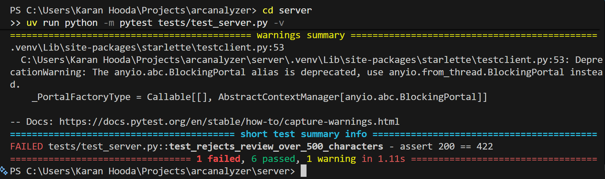
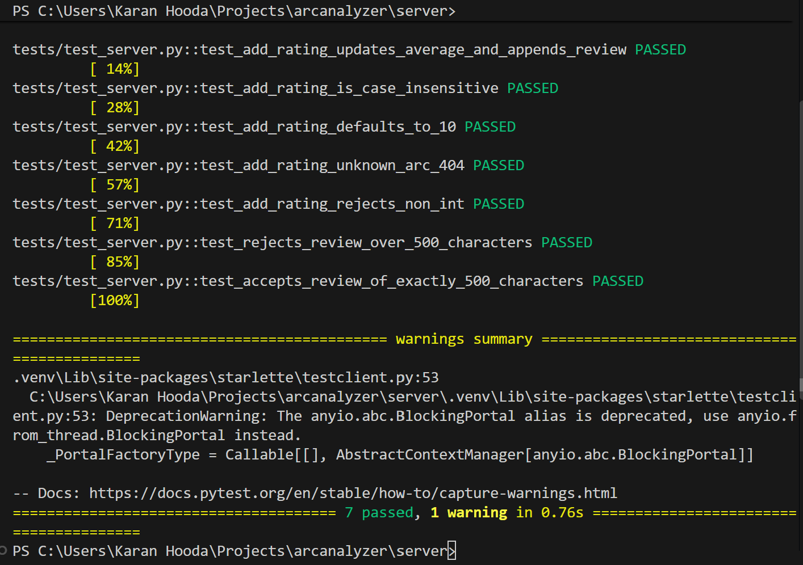
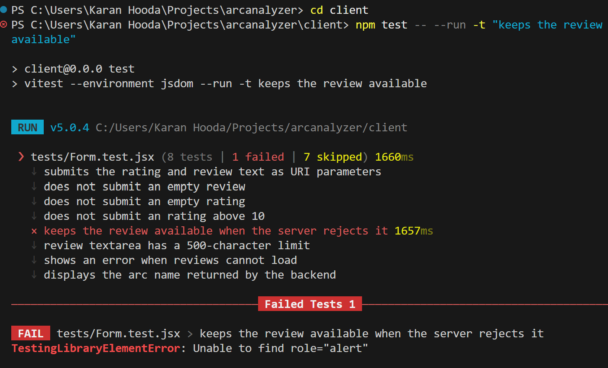
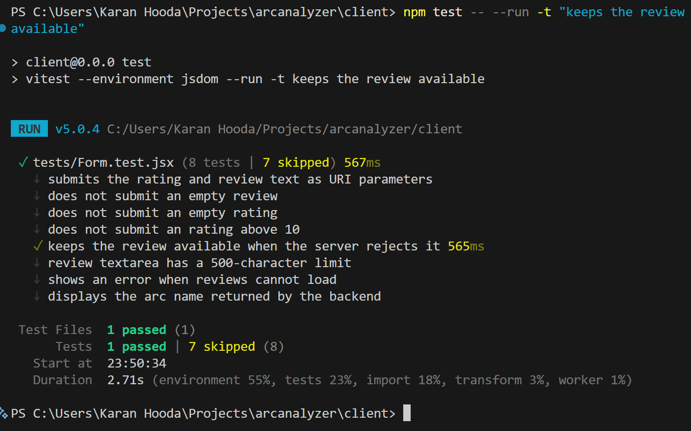

# Karan Hooda

## Bug Fix 1: Review Character Limit (KH-01)

**GitHub Issue:** [Issue #102 - Character limit on textbox for review doesn't exist](https://github.com/rn727/arcanalyzer/issues/102)

**Pull Request:** [PR #122 - Fixed 500-character limit on review text box](https://github.com/rn727/arcanalyzer/pull/122)

**Bug Classification:** Code bug — The test correctly expected reviews longer than 500 characters to be rejected, but the backend accepted a 501-character review with HTTP 200 instead of rejecting it.

### Before Fix

### After Fix

---

## Bug Fix 2: Failed Review Submission Error Message (KH-02)

**GitHub Issue:** [Issue #123 - Failed review submission does not display an error message](https://github.com/rn727/arcanalyzer/issues/123)

**Pull Request:** [\[Add PR link after creating pull request\]](https://github.com/rn727/arcanalyzer/pull/133)

**Bug Classification:** Code bug — The test correctly expected a visible error message when a review submission failed, but the frontend only logged HTTP errors to the console and did not handle network failures.

### Before Fix

### After Fix

---

## AI Disclosure

I used ChatGPT to help identify and understand the causes of both bugs, explain the necessary code changes, and assist with creating and running automated tests. I reviewed and applied the changes in VS Code and used the test results to verify the fixes.