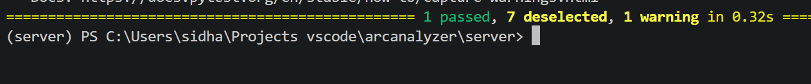
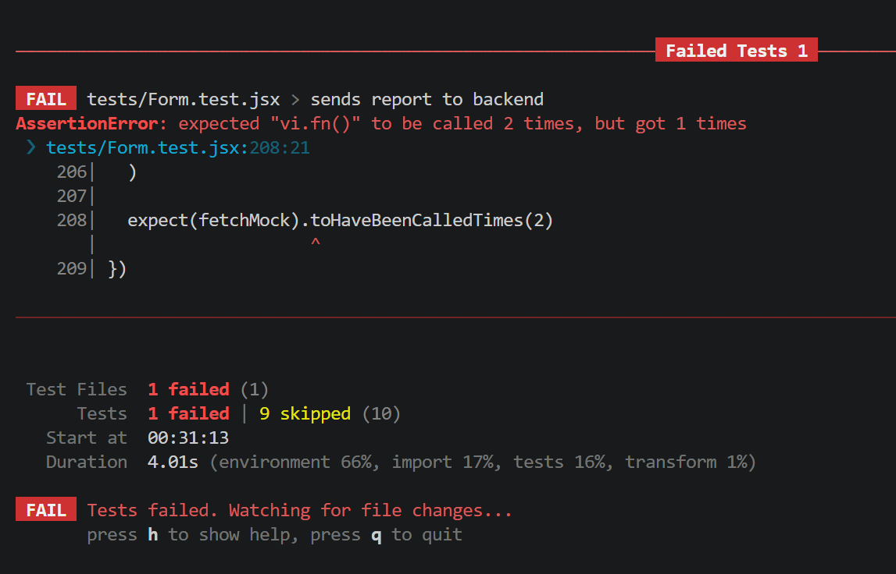
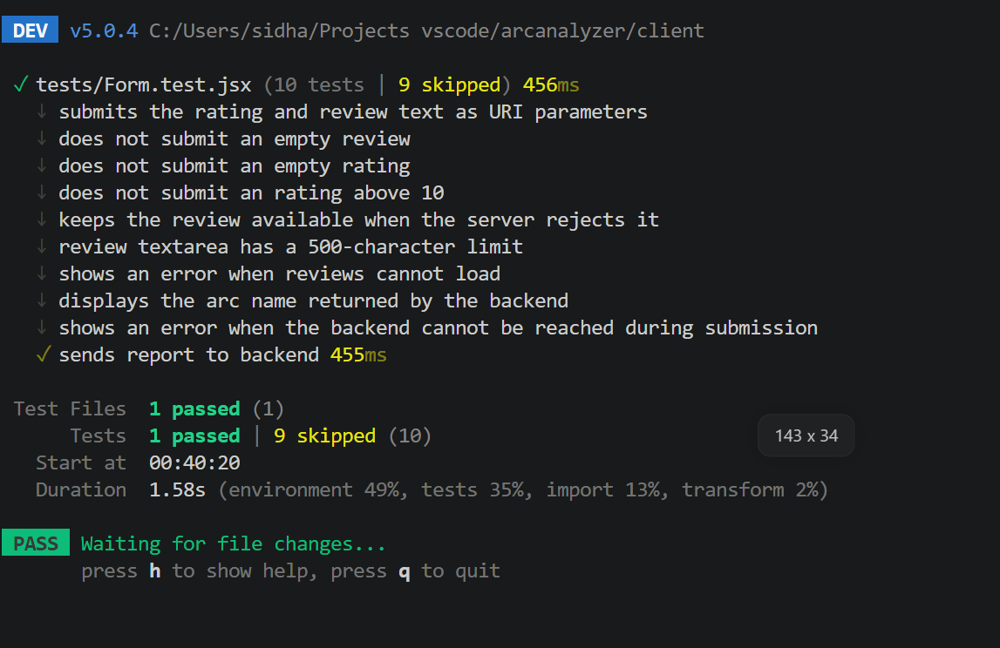

# Sidharth Nair

## Issue #89: Comment reporting needs to be implemented

Issue: [https://github.com/rn727/arcanalyzer/issues/89](https://github.com/rn727/arcanalyzer/issues/89)  
PR: [https://github.com/rn727/arcanalyzer/pull/132](https://github.com/rn727/arcanalyzer/pull/132)

This was a code bug because the backend did not have a report endpoint, so attempting to submit a report returned a 404 error.

I added a backend report endpoint and a test that verifies the endpoint exists and accepts a valid report. The test passed after the fix.

## Test Results

- Backend tests: `8 passed`
- Issue #89 test: `passed`
- Issue #115 test: passed

## Issue #115: Reports are not sent to the backend

Issue: [https://github.com/rn727/arcanalyzer/issues/115](https://github.com/rn727/arcanalyzer/issues/115)  
PR: [https://github.com/rn727/arcanalyzer/pull/138](https://github.com/rn727/arcanalyzer/pull/138)

This was a code bug because the frontend displayed that a report was submitted, but it didnt actually send the report to the backend.

I added a backend request when a report is submitted and added a test that verifies the request is sent. The test passed after the fix.

## AI Disclosure

- Used ChatGPT in order to create test examples based on existing repo code. 